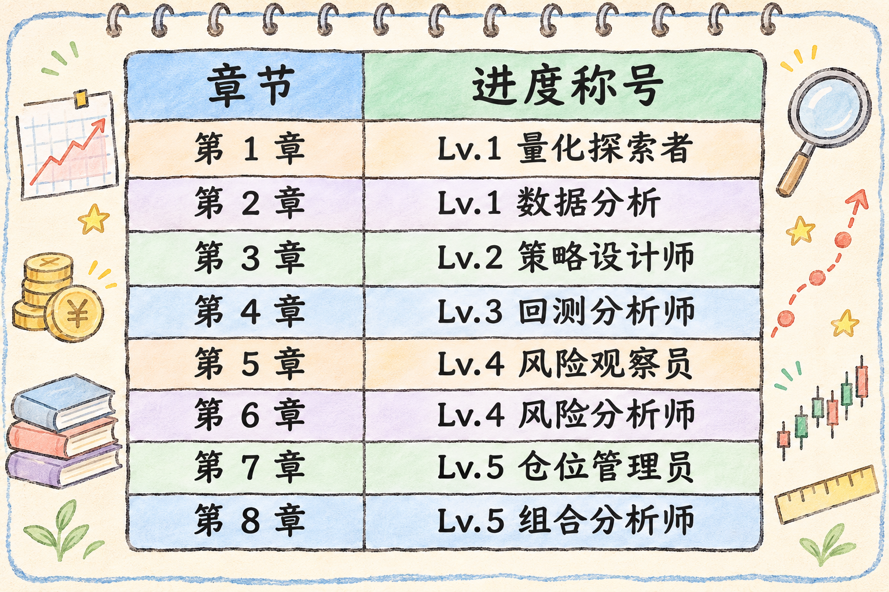

<p align="center">
  
</p>
<p align="center">
  
</p>

# 零基础学习量化金融

<p align="center">
  <strong>Quant-for-babies</strong> · 中文零基础量化金融 Notebook 路线 · 第一期、第二期与番外期课件已上线
</p>

<p align="center">
  <a href="requirements.txt"></a>
  <a href="notebooks/"></a>
  <a href="notebooks/phase1_intro/"></a>
  <a href="notebooks/phase2_intro/"></a>
</p>

<p align="center">
  <a href="#快速开始">快速开始</a> ·
  <a href="#课程目录">课程目录</a> ·
  <a href="#番外期--第二期课前培训">番外期</a> ·
  <a href="#学习路线">学习路线</a> ·
  <a href="#后续规划">后续规划</a>
</p>

---

## 简介

这是一份面向**零基础**读者的中文量化金融教程：每章配有可运行的 Notebook 和配套交互演示，边读边跑，把概念落到真实行情上。本课程侧重可运行的代码与清晰图示，而非堆砌公式。内容持续更新，欢迎 Star 方便日后查阅。

| 项目 | 说明 |
|------|------|
| 形式 | Jupyter Notebook + 配套交互 HTML + 番外期长篇在线教程 |
| 数据 | `yfinance` · `akshare` 免费日线行情 |
| 第一期 | 4 章 |
| 第二期 | 4 章|
| 番外期 | 第一讲：量化投资入门与完整研究流程；第二讲：Python、pandas与SQL金融数据工程 |
| 不适合 | 已具备完整回测框架、仅需高级因子参考的读者 |

---

## 快速开始

```bash
git clone https://github.com/ThreshoLdnnis/Quant-for-babies.git
cd Quant-for-babies
pip install -r requirements.txt
jupyter lab
```

---

## 课程目录

### 第一期 · 量化入门

| 章 | 主题 | Notebook | 你将完成 |
|:--:|------|----------|----------|
| 01 | 什么是量化金融 | [打开](notebooks/phase1_intro/01_什么是量化金融.ipynb) | 建立量化直觉；下载真实 AAPL 行情 |
| 02 | 你的第一个量化实验 | [打开](notebooks/phase1_intro/02_你的第一个量化实验.ipynb) | OHLCV、收益率、波动对比 |
| 03 | 移动平均线策略 | [打开](notebooks/phase1_intro/03_移动平均线策略.ipynb) | MA5/MA20、金叉/死叉、首个交易规则 |
| 04 | 策略回测 | [打开](notebooks/phase1_intro/04_策略回测.ipynb) | 模拟交易、净值曲线、胜率与回撤 |

### 第二期 · 风险与组合

| 章 | 主题 | Notebook | 你将完成 |
|:--:|------|----------|----------|
| 05 | 理解波动率 | [打开](notebooks/phase2_intro/01_理解波动率.ipynb) | 波动率度量、年化换算、多票对比 |
| 06 | 夏普比率与 Beta | [打开](notebooks/phase2_intro/02_夏普比率与Beta.ipynb) | 风险调整收益、个股相对大盘敏感度 |
| 07 | 最大回撤与仓位管理 | [打开](notebooks/phase2_intro/03_最大回撤与仓位管理.ipynb) | 回撤测算、仓位与风险承受 |
| 08 | 多标的组合与相关性 | [打开](notebooks/phase2_intro/04_多标的组合与相关性.ipynb) | 等权组合、相关性矩阵、分散化 |

### 番外期 · 第二期课前培训

| 讲 | 主题 | 课件 | 讲者材料 |
|:--:|------|------|------|
| 01 | 量化投资入门与完整研究流程 | [打开 13 页交互式 HTML 课件](extras/lecture-01/index.html) | [完整逐页讲者备注](extras/lecture-01/lecture-notes.md) |
| 02 | Python、pandas与SQL金融数据工程 | [打开长篇 HTML 在线教程](extras/lecture-02/index.html) | [运行说明](extras/lecture-02/README.md) · [完整离线实操](extras/lecture-02/lab.py) |

第一讲课件可下载后直接在浏览器打开，无需安装依赖或联网。使用左右方向键、空格键或屏幕下方按钮翻页；按 N 查看完整讲者备注，O 打开总览，F 全屏投屏。所有图表数值均标注为模拟教学数据。

第二讲采用完整、连续纵向阅读的知识库页面，包含章节锚点、阅读进度、字段字典、公式、模拟图表、代码复制、实操与折叠答案。只需下载 `extras/lecture-02/index.html` 即可离线阅读，样式与交互已内置；Python 实操需安装该讲依赖，AkShare 真实采集为联网选做。GitHub文件页显示源码，页面运行方式见[第二讲说明](extras/lecture-02/README.md)。

### 配套交互演示

在浏览器本地打开（无需联网，对应各章公式推导）：

| 演示 | 链接 | 对应章节 |
|------|------|----------|
| 布朗运动与随机游走 | [打开](assets/interactive/brownian-random-walk.html) | 第一期 · 第一章 |
| 日收益率 | [打开](assets/interactive/daily-return-demo.html) | 第二期 · 理解波动率 |
| 样本标准差 | [打开](assets/interactive/std-dev-demo.html) | 第二期 · 理解波动率 |
| 总体方差 | [打开](assets/interactive/population-variance-demo.html) | 第二期 · 理解波动率 |
| 方差修正公式 | [打开](assets/interactive/variance-formulas-demo.html) | 第二期 · 理解波动率 |
| 夏普比率 | [打开](assets/interactive/sharpe-ratio-demo.html) | 第二期 · 夏普比率与 Beta |
| Beta | [打开](assets/interactive/beta-demo.html) | 第二期 · 夏普比率与 Beta |

更多说明见 [assets/interactive/README.md](assets/interactive/README.md)。

---

## 章节预览

<p align="center">
  
  
</p>
<p align="center">
  
  
</p>

<p align="center"><sub>章节示意图见 <code>assets/images/</code>；本地运行 Notebook 可得到交互式图表</sub></p>

---

## 学习路线

```
Phase 1（已上线）
├── 01 量化认知与真实数据
├── 02 收益率与数据分析
├── 03 双均线策略
└── 04 策略回测

Phase 2（已上线）
├── 05 理解波动率
├── 06 夏普比率与 Beta
├── 07 最大回撤与仓位管理
└── 08 多标的组合与相关性

番外期（已上线）
├── 第一讲 量化投资入门与完整研究流程 · 13 页 HTML 培训课件
└── 第二讲 Python、pandas与SQL金融数据工程 · 长篇 HTML 在线教程与离线实操

Phase 3（规划）  因子 · 多因子选股
Phase 4（规划）  机器学习与 AI 量化
```

<p align="center">
  
</p>

---

## 仓库结构

```
Quant-for-babies/
├── notebooks/
│   ├── phase1_intro/         # 第一期（第 1～4 章）
│   └── phase2_intro/         # 第二期（第 5～8 章）
├── assets/
│   ├── images/               # README 与传播用配图
│   └── interactive/          # 独立 HTML 交互演示
├── extras/
│   ├── lecture-01/           # 番外期第一讲：HTML 幻灯片与逐页讲者备注
│   └── lecture-02/           # 番外期第二讲：长篇 HTML 教程、Python 实操与采集脚本
├── scripts/                  # 配图生成、Notebook 维护脚本
├── docs/ROADMAP.md           # 详细路线图
├── src/                      # 可复用模块（建设中）
└── requirements.txt
```

---

## 后续规划

| 章节 | 主题 | 状态 |
|------|------|------|
| 09 | AI 预测涨跌（入门） | 规划中 |
| 10 | XGBoost 量化策略 | 规划中 |
| 11 | LSTM 时间序列 | 规划中 |
| 12 | Transformer 交易 | 规划中 |
| 13 | 多因子选股 | 规划中 |
| 14 | AI 量化系统搭建 | 规划中 |

完整说明见 [docs/ROADMAP.md](docs/ROADMAP.md)。

---

## 免责声明

本仓库仅供学习与研究，**不构成任何投资建议**。历史回测结果不代表未来表现，市场有风险。

---

<p align="center">
  <sub>如果这份路线对你有帮助，欢迎 Star ⭐</sub>
</p>
