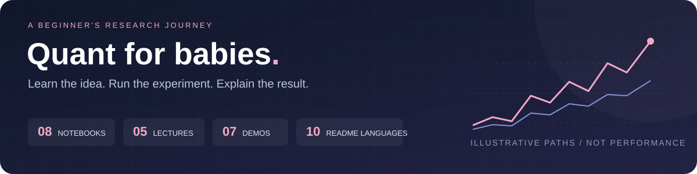

<p align="center">
  
</p>

<p align="center">
  <a href="../../README.md">简体中文</a> · <a href="README.zh-TW.md">繁體中文</a> · <a href="README.en.md">English</a> · <a href="README.ru.md">Русский</a> · <a href="README.ja.md">日本語</a> · <strong>한국어</strong> · <a href="README.fr.md">Français</a> · <a href="README.de.md">Deutsch</a> · <a href="README.es.md">Español</a> · <a href="README.hi.md">हिन्दी</a>
</p>

# 실험을 하나씩 따라 하며 배우는 퀀트 금융

첫 시장 데이터부터 신호, 위험, 포트폴리오, 재현 가능한 연구까지 차근차근 배웁니다. **Jupyter Notebook 8개, 연구 강의 5개, 브라우저 데모 7개**와 함께 시작하세요.

**번역 범위:** 이 안내서와 탐색 메뉴는 10개 언어로 제공됩니다. Notebook, 강의, 대부분의 관련 문서는 현재 **중국어 간체**로 작성되어 있습니다. README 언어를 바꿔도 교육 자료 본문이 번역되지는 않습니다.

<p align="center">
  <a href="#start">시작하기</a> · <a href="#setup">환경 설정</a> · <a href="#curriculum">Notebook</a> · <a href="#labs">연구 실습</a> · <a href="#demos">데모</a> · <a href="#faq">도움말</a>
</p>

| 제공 내용 | 형식 | 할 수 있는 것 |
| --- | --- | --- |
| 01~08장 · 제공 중 | Jupyter Notebook | 가격 분석, 이동평균 규칙 작성, 위험 측정, 포트폴리오 비교 |
| 01~05강 · 제공 중 | 오프라인 HTML + Python 실습 4개 | 데이터 → 팩터 → 평가 → 시뮬레이션 백테스트 과정 수행 |
| 대화형 데모 7개 · 제공 중 | 독립 실행 HTML | 연구 환경을 설치하지 않고 수식을 시각적으로 이해 |
| 후속 장과 심화 프로젝트 · 계획 중 | [로드맵](../ROADMAP.md) | 예정된 주제와 제공 중인 수업을 구분하여 확인 |

<a id="start"></a>
## 1. 나에게 맞는 시작점 선택하기

| 목표 | 시작할 곳 | 첫 번째 결과물 |
| --- | --- | --- |
| 코딩 전에 개념부터 이해하고 싶다 | [01강](../../extras/lecture-01/index.html)과 [데모](#demos) | 퀀트 연구 과정의 각 단계를 설명 |
| Python을 작성하고 실행하며 배우고 싶다 | [환경 설정](#setup) 후 [Notebook 01](../../notebooks/phase1_intro/01_什么是量化金融.ipynb) | 시장 데이터를 불러오고 첫 가격 차트 작성 |
| 전체 연구 파이프라인을 실습하고 싶다 | [02~05강](#labs)을 순서대로 학습 | 데이터 검사, 팩터 표, 평가 보고서, 모의 거래 원장 생성 |
| 워크숍을 진행하거나 팀과 함께 공부하고 싶다 | [01강 발표자 노트](../../extras/lecture-01/lecture-notes.md)와 실습 안내 | 연습 문제와 확인 가능한 결과물을 활용해 학습 모임 진행 |

퀀트 금융 경험은 없어도 됩니다. Python 기초를 알면 Notebook 학습에 도움이 되지만, 먼저 HTML 자료를 읽으며 시작해도 좋습니다. 각 수업에서 **읽기 → 실행하기 → 가정 하나 바꾸기 → 결과 설명하기**를 반복하세요.

### HTML 수업 읽기

**GitHub에서는 HTML 소스가 표시됩니다. 저장소의 파일 링크만 열어서는 수업이 실행되지 않습니다.** **Code → Download ZIP**으로 저장소를 내려받고 압축을 푼 뒤, 브라우저에서 `extras/lecture-0N/index.html`을 여세요. 강의 페이지 5개와 데모 7개는 로컬에서 오프라인으로 볼 수 있습니다. 외부 참고 링크와 최신 데이터 다운로드에는 인터넷 연결이 필요합니다.

또는 저장소 루트 디렉터리에서 다음을 실행하세요.

```bash
python -m http.server 8000 --bind 127.0.0.1
```

`http://127.0.0.1:8000/extras/lecture-01/`을 여세요. 다른 강의는 `01`을 `02`~`05`로 바꾸면 됩니다. macOS/Linux에서 `python`을 사용할 수 없다면 `python3`를 사용하세요. `Ctrl+C`로 서버를 종료합니다.

01강에서는 방향키나 스페이스바로 페이지를 넘깁니다. `N`은 발표자 노트, `O`는 전체 보기, `F`는 전체 화면입니다.

<a id="setup"></a>
## 2. Notebook 환경 설정하기

**Python 3.10 이상**을 사용하세요. 처음 시작한다면 Python 3.12가 적절한 선택입니다. Git을 설치해 저장소를 복제하거나 ZIP을 내려받아 압축을 푸세요. 다음 명령은 터미널에서 실행합니다. 가상 환경의 실행 파일 경로를 직접 사용하면 셸 활성화 문제를 피할 수 있습니다.

<details>
<summary><strong>Windows · PowerShell</strong></summary>

```powershell
git clone https://github.com/ThreshoLdnnis/Quant-for-babies.git
cd Quant-for-babies
python -m venv .venv
.\.venv\Scripts\python.exe -m pip install -r requirements.txt
.\.venv\Scripts\python.exe -m jupyterlab
```

ZIP을 내려받았다면 압축을 푼 저장소 폴더에서 PowerShell을 열고 `python -m venv .venv`부터 실행하세요.

</details>

<details>
<summary><strong>macOS / Linux · 터미널</strong></summary>

```bash
git clone https://github.com/ThreshoLdnnis/Quant-for-babies.git
cd Quant-for-babies
python3 -m venv .venv
.venv/bin/python -m pip install -r requirements.txt
.venv/bin/python -m jupyterlab
```

ZIP을 내려받았다면 압축을 푼 저장소 폴더에서 터미널을 열고 `python3 -m venv .venv`부터 실행하세요.

</details>

Jupyter가 터미널에 로컬 URL을 표시합니다. 브라우저에서 해당 주소를 열고 `notebooks/phase1_intro/01_什么是量化金融.ipynb`를 선택한 다음, 셀을 위에서 아래로 실행하세요(`Shift+Enter`). 방금 만든 환경을 Notebook이 사용하는지 확인하세요.

| 의존 패키지 | 용도 | 설치 파일 |
| --- | --- | --- |
| Jupyter, NumPy, pandas, Matplotlib, seaborn | Notebook 실행, 표와 차트 | [루트 의존성 파일](../../requirements.txt) |
| yfinance, AkShare | 시장 데이터 예제, 인터넷 연결 필요 | 루트 의존성 파일 |
| scikit-learn | 학습 환경의 머신러닝 도구 | 루트 의존성 파일, 후속 AI 장은 계획 중 |
| 강의별 의존성 | 오프라인 연구 실습, 04강에는 SciPy도 필요 | 각 강의 폴더의 `requirements.txt` |
| 선택적 시각화 패키지 | 실습 그림 내보내기 | 03~05강의 `requirements-plot.txt` |

<a id="curriculum"></a>
## 3. Notebook 8개를 순서대로 따라가기

각 단계 안에서는 순서대로 학습하세요. 차트, 바꾼 매개변수, 결과에 대한 짧은 설명을 저장하세요.

| 장 | 주제 / Notebook | 학습 결과 |
| :---: | --- | --- |
| 01 | [퀀트 금융이란?](../../notebooks/phase1_intro/01_什么是量化金融.ipynb) | 기본 개념을 이해하고 AAPL 가격 데이터 다운로드 |
| 02 | [첫 번째 퀀트 실험](../../notebooks/phase1_intro/02_你的第一个量化实验.ipynb) | OHLCV 읽기, 수익률 계산, 변동성 비교 |
| 03 | [이동평균 전략](../../notebooks/phase1_intro/03_移动平均线策略.ipynb) | MA5/MA20 교차를 명확한 거래 규칙으로 변환 |
| 04 | [전략 백테스트](../../notebooks/phase1_intro/04_策略回测.ipynb) | 거래를 시뮬레이션하고 자산 곡선, 승률, 낙폭 확인 |
| 05 | [변동성 이해하기](../../notebooks/phase2_intro/01_理解波动率.ipynb) | 자산별 변동성을 측정하고 연율화 |
| 06 | [샤프 지수와 베타](../../notebooks/phase2_intro/02_夏普比率与Beta.ipynb) | 위험 조정 수익률과 시장 민감도 비교 |
| 07 | [최대 낙폭과 포지션 관리](../../notebooks/phase2_intro/03_最大回撤与仓位管理.ipynb) | 낙폭을 익스포저 및 위험 감내 수준과 연결 |
| 08 | [포트폴리오와 상관관계](../../notebooks/phase2_intro/04_多标的组合与相关性.ipynb) | 동일 비중 포트폴리오를 구성하고 분산 효과 탐색 |

**1단계 · 01~04장:** 데이터 → 수익률 → 규칙 → 백테스트.<br />
**2단계 · 05~08장:** 변동성 → 위험 조정 지표 → 포지션 관리 → 포트폴리오.

<details>
<summary>처음 네 장 미리 보기</summary>

<p>
  
  
</p>
<p>
  
  
</p>

</details>

<a id="labs"></a>
## 4. 다섯 강의로 연구 과정 완성하기

이 강의들은 Notebook 내용을 보완합니다. 연구 흐름을 익히려면 순서대로 읽으세요. **전체 저장소 구조를 유지하세요.** 04강과 05강 실습은 03강의 코드를 불러옵니다.

| 강의 | 읽을 자료 | 실습 및 예상 결과물 |
| :---: | --- | --- |
| 01 | [연구 과정](../../extras/lecture-01/index.html) · [발표자 노트](../../extras/lecture-01/lecture-notes.md) | 입문 슬라이드 13장, Python 실습 없음 |
| 02 | [금융 데이터 엔지니어링](../../extras/lecture-02/index.html) · [실행 안내](../../extras/lecture-02/README.md) | pandas, SQLite/SQL, 정제와 문제 데이터 격리 → CSV 표, 데이터베이스, 품질 보고서 |
| 03 | [팩터와 전처리](../../extras/lecture-03/index.html) · [실행 안내](../../extras/lecture-03/README.md) | MOM20, VOL20, TURN20, MAD, 횡단면 Z 점수 → 팩터 표와 진단 결과 |
| 04 | [팩터 평가와 통계](../../extras/lecture-04/index.html) · [실행 안내](../../extras/lecture-04/README.md) | Rank IC, ICIR, 그룹 분석, 시간순 평가 → 평가 표와 감사 보고서 |
| 05 | [다중 팩터 백테스트](../../extras/lecture-05/index.html) · [실행 안내](../../extras/lecture-05/README.md) | 정적 점수, 상위 N개 종목, 다음 시가 체결, 비용 → 모의 계좌, 거래 원장, 연구 요약 |

### 오프라인 실습 네 개 실행하기

가상 환경을 활성화한 뒤 저장소 루트에서 다음을 실행하세요. 또는 모든 `python`을 Windows에서는 `.\.venv\Scripts\python.exe`, macOS/Linux에서는 `.venv/bin/python`으로 바꾸세요.

```bash
python -m pip install -r extras/lecture-02/requirements.txt
python extras/lecture-02/lab.py --output work/lecture-02-run

python -m pip install -r extras/lecture-03/requirements.txt
python extras/lecture-03/factor_lab.py --output work/lecture-03-run

python -m pip install -r extras/lecture-04/requirements.txt
python extras/lecture-04/evaluation_lab.py --output work/lecture-04-run

python -m pip install -r extras/lecture-05/requirements.txt
python extras/lecture-05/backtest_lab.py --output work/lecture-05-run
```

실습마다 전용 출력 디렉터리를 사용하세요. 스크립트는 관련 없는 비어 있지 않은 디렉터리를 보호합니다. 출력 경로를 변경하거나 다시 사용하기 전에 해당 강의 안내를 확인하세요. 선택적 시각화 스크립트와 인터넷에 연결하여 AkShare 데이터를 수집하는 연습은 각 강의 폴더에 설명되어 있습니다.

**결과 해석 방법:** 핵심 실습은 결정적으로 생성되는 **교육용 모의 데이터**를 사용하며, 의존 패키지 설치 후에는 시장 데이터 연결이 필요하지 않습니다. 짧은 표본과 가정한 비용은 방법을 설명하기 위한 것으로, 실제 투자 가능한 전략이나 정식 표본 외 성과를 입증하지 않습니다. Notebook은 실제 과거 가격을 다운로드할 수 있습니다. 일부 데모에는 과거 데이터 스냅샷이 내장되어 있으며, 조작해도 실시간 가격을 가져오지 않습니다.

<a id="demos"></a>
## 5. 개념을 시각적으로 살펴보기

HTML 파일을 내려받아 열거나 위에서 설명한 로컬 서버를 사용하세요. [데모 안내](../../assets/interactive/README.md)에서 데이터와 동작 방식을 설명합니다.

| 데모 | 함께 볼 장 | 해 볼 것 |
| --- | --- | --- |
| [브라운 운동 / 랜덤 워크](../../assets/interactive/brownian-random-walk.html) | 01장 | 경로를 비교하고 무작위성과 예측을 구분 |
| [일간 수익률](../../assets/interactive/daily-return-demo.html) | 05장 | 가격에서 수익률을 구하는 과정 확인 |
| [표본 표준편차](../../assets/interactive/std-dev-demo.html) | 05장 | 편차와 집계 과정 살펴보기 |
| [모분산](../../assets/interactive/population-variance-demo.html) | 05장 | 정의를 시각적 예제와 연결 |
| [분산 보정](../../assets/interactive/variance-formulas-demo.html) | 05장 | `n`과 `n−1`의 역할 비교 |
| [샤프 지수](../../assets/interactive/sharpe-ratio-demo.html) | 06장 | 초과 수익률과 변동성 비교 |
| [베타](../../assets/interactive/beta-demo.html) | 06장 | 자산과 벤치마크의 관계 탐색 |

<a id="roadmap"></a>
## 6. 다음에 배울 내용 확인하기

| 상태 | 범위 | 확인할 곳 |
| --- | --- | --- |
| 제공 중 | Notebook 8개, 강의 5개, 데모 7개 | 위의 표 |
| 계획 중 · 09~14장 | 머신러닝 입문, XGBoost, LSTM, Transformer, 다중 팩터 종목 선택, AI 퀀트 시스템 | [상세 로드맵](../ROADMAP.md) |
| 계획 중 · 심화 프로젝트 | 금융 NLP/RAG 도우미, 시장 상태에 따른 팩터 배분, 머신러닝 종목 선택과 설명 가능한 Alpha | [프로젝트 제안](../ROADMAP.md#advanced-projects) |
| 구축 중 | `src/`의 재사용 모듈 | 현재는 자리표시자이며 실운영용 백테스트 프레임워크가 아님 |

### 저장소 구조 살펴보기

| 경로 | 내용 |
| --- | --- |
| [`notebooks/`](../../notebooks/) | 1단계와 2단계 수업 |
| [`extras/`](../../extras/) | 강의 HTML, 안내, 실습, 선택적 시각화 도구 |
| [`assets/interactive/`](../../assets/interactive/) | 브라우저 데모 7개 |
| [`assets/images/`](../../assets/images/) | 수업 그림과 README 이미지 |
| [`docs/`](../) | 로드맵과 다국어 README 안내서 |
| [`scripts/`](../../scripts/) | Notebook 관리 및 수업 이미지 생성 도구 |
| [`requirements.txt`](../../requirements.txt) | Notebook 환경 의존 패키지 |

<a id="faq"></a>
## 7. 문제가 생겼을 때

| 질문 | 해결 방법 |
| --- | --- |
| GitHub에 HTML 코드가 보이는 이유는? | 파일을 내려받아 열거나 [시작하기](#start)에 나온 로컬 HTTP 서버를 사용하세요. |
| Jupyter에서 패키지를 찾을 수 없는 이유는? | 같은 환경의 `python -m pip`로 설치하세요. 선택된 커널을 확인하고 설치 후 다시 시작하세요. |
| 시장 데이터 다운로드가 실패한 이유는? | 네트워크와 공급자의 응답을 확인하세요. 빈 데이터를 성공한 실험으로 취급하지 마세요. 오프라인 강의 실습으로 학습을 계속할 수 있습니다. |
| 실습이 출력 디렉터리를 거부하는 이유는? | 새 전용 디렉터리를 선택하거나, 실습의 소유 표시가 있는 출력 폴더를 다시 실행하는 규칙을 따르세요. |
| 언어를 바꾸면 Notebook도 번역되나요? | 아닙니다. README 안내서는 10개 언어지만, 교육 본문은 주로 중국어 간체입니다. |
| 문제를 어떻게 신고하나요? | [Issue를 열고](https://github.com/ThreshoLdnnis/Quant-for-babies/issues) 파일 경로, 명령, Python 버전, 오류 메시지를 적어 주세요. 로그에서 토큰과 개인 정보를 제거하세요. |

수정, 더 명확한 예제, 꼼꼼히 검토한 번역을 환영합니다. 10개 안내서의 코드 경로와 명령을 일치시켜 주세요. [번역 유지보수 안내](README.md)를 참고하세요.

---

**라이선스:** [MIT](../../LICENSE). **교육 목적:** 이 저장소는 학습과 연구를 위한 것이며 투자 조언이 아닙니다. 과거 또는 모의 결과는 미래 성과를 보장하지 않습니다.
