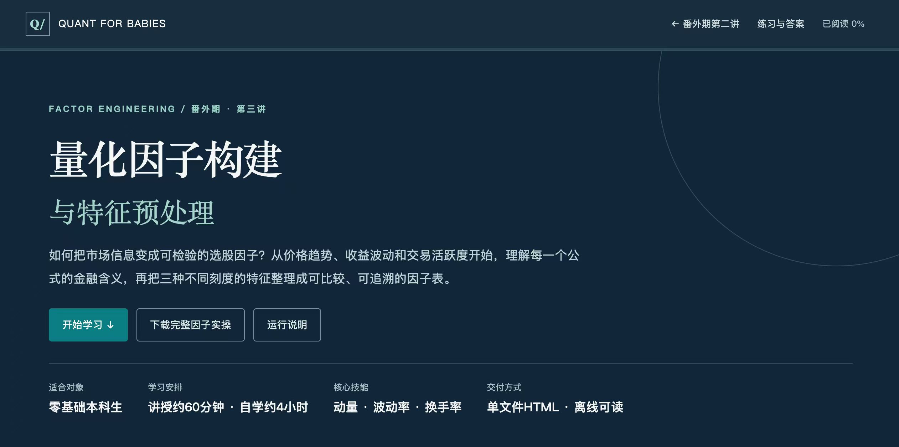

<p align="center">
  
</p>

# 番外期·第三讲：量化因子构建与特征预处理

[打开完整HTML教程](index.html) · [下载实操代码](factor_lab.py) · [第二讲](../lecture-02/README.md) · [课程目录](../../README.md)

本讲按PPT03的14项规划扩写为连续纵向阅读课程。属于《量化金融研究基础与多因子策略实战》系列，只讨论因子构建与特征预处理；不提前实现IC检验、策略回测、动态配置或机器学习选股。

## 阅读

**只下载 `index.html`，双击即可阅读。** 样式、交互和可下载的Python附件都已内置，不依赖同目录文件或外部图表库。包括目录、阅读进度、代码复制、动量窗口与MAD交互、模拟相关矩阵、公式、逐行解释和折叠答案。外部文献与GitHub导航需要联网。

GitHub文件页显示源码。可下载后打开，或在仓库根目录运行 `python -m http.server 8000 --bind 127.0.0.1`，访问 `http://127.0.0.1:8000/extras/lecture-03/`。这不是已配置的GitHub Pages地址。

## 内容对应

| PPT03主题 | 教程内容 |
|---|---|
| 01–03 因子、标签与二维数据 | 因子≠指令；X/Y隔离；时间序列与横截面 |
| 04–07 三因子与时间边界 | MOM20、VOL20、TURN20；20个间隔与21个价格；交易日期网格 |
| 08–12 预处理 | 缺失、MAD、Z-score、固定方向、相关性与冗余 |
| 13–14 计算与验收 | 完整程序、输入输出、手算练习、答案、课后交付与质量检查 |

## 运行核心实验

要求Python 3.10+，在仓库根目录执行：

```bash
python -m venv .venv
# Windows
.venv\Scripts\python -m pip install -r extras/lecture-03/requirements.txt
.venv\Scripts\python extras/lecture-03/factor_lab.py --output data/processed/lecture03-simulation
```

macOS / Linux将解释器换成 `.venv/bin/python`。已有第二讲环境可复用。只下载HTML的读者，可用页面按钮下载 `factor_lab.py`、`requirements.txt` 放在同一文件夹，去掉以上命令的仓库目录前缀。

本实验只生成确定性模拟数据，不联网。8只虚构证券SIM001–SIM008，80个pandas工作日，不是真实A股交易日历。SIM001/2的底层价格与成交量公式沿用第二讲，再扩展其他股票并注入本讲缺失案例；不与第二讲脏数据文件逐行等同。模拟无公司行为，`adj_close`等于模拟原始价，不冒充真实复权快照。

固定输入639行，补成640行日期网格；原始因子MOM20/VOL20各427个非空值，TURN20有448个。固定相关截面为2024-04-22，8只共同有效股票。这些是教学运行结果，不是真实A股收益或因子有效性证据。

## 预先规定的口径

- `mom20=P[t]/P[t-20]-1`。数学公式只用端点；本实验另要求21个连续有效价格作为保守质量政策。
- `ret_1d`不填补缺失；VOL20使用20个日收益的样本标准差，`ddof=1`，不年化。
- TURN20使用20个换手率的均值。输入为小数，0.025表示2.5%；无法确认换手率时保留缺失，不自动换成成交量。
- 每个日期先取三因子共同有效且在预定股票池的股票，`min_n=5`，不满足则得分为空。5是教学参数，不是可靠性的通用阈值。
- 原始MAD，边界为中位数±3MAD，不乘1.4826；MAD=0保留并标记。
- 裁剪后逐日横截面Z-score使用`ddof=0`；常量或标准差为零时得分为空。
- 方向固定为MOM +1、VOL −1、TURN −1，仅是教学假设，不用未来标签或最终测试期调方向。
- 因子间相关矩阵使用同一日期、同一组股票的Pearson相关，不是Rank IC。

## 输出

`raw_simulated.csv`、`calendar_simulated.csv`、`factors_raw.csv`、`factors_processed.csv`、`preprocessing_audit.csv`、`factor_definitions.csv`、`correlation_raw.csv`、`correlation_z.csv`、`chart_data.json`、`quality_report.json`。

程序只管理带本实验标记的专用目录，拒绝覆盖其他非空目录。原始因子、裁剪值、Z值和方向得分分列保留；窗口不足或不可用的结果不填零。正式研究应替换为经过核查的真实交易日历、历史股票池、调整价格与时点信息，不能直接把本模拟日历改名为A股数据。

## 可选绘图

```bash
.venv\Scripts\python -m pip install -r extras/lecture-03/requirements-plot.txt
.venv\Scripts\python extras/lecture-03/plot_factors.py --input data/processed/lecture03-simulation/chart_data.json --output data/processed/lecture03-figures
```

绘图脚本输出带SIMULATED标识的因子分布与相关热力图（PNG/SVG）。每个因子的前后分布采用相同坐标与分箱。图上只有8只模拟股票，不用于判断总体分布或统计显著性。

## 维护

`index.html`保留课程正文；`course.css`、`course.js`为可维护源文件。修改样式、交互或附件后，运行 `python scripts/build_lecture03_standalone.py`，重新内置资源。重复运行不会重复插入。

第一期、第二期、番外期第一讲和第二讲内容保持不变，根README只增加第三讲入口。

## 验证记录

2026-11-08：16个阅读单元覆盖PPT03的14项主题，18个代码块中15段Python示例均已执行；HTML结构、锚点、内置附件与源文件一致性检查通过。完整实验16项质量检查在pandas 3.0.1和3.1.1下通过，重复运行CSV/JSON一致，图表、网页表格与固定截面数据对齐。

浏览器已检查1440px桌面、390px和320px手机宽度，无整页横向溢出；动量与MAD交互、阅读进度、复制反馈、目录与折叠答案可用。分布图与相关图已检查单位、日期、样本数、模拟声明和坐标口径。
